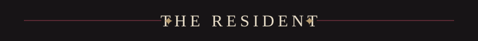
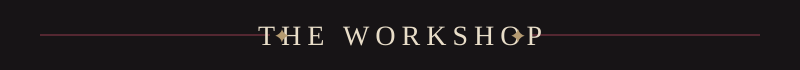
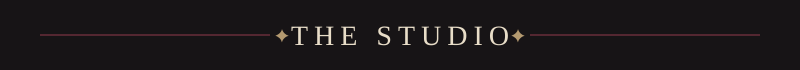

  
  
  

✦ &nbsp;<i>Roblox developer · digital artist · musician</i>&nbsp; ✦

Ayden, also known as <b>saintsblades</b> 
San Francisco, California, USA 
Roblox development · digital art · music

3 years coding in Luau ✦ 1M+ visits on Roblox 
22k followers on TikTok for my digital art ✦ 1.1M+ likes on my animations 
Roblox Studio · Luau · Blender · Moon Animator · FL Studio · Procreate · ibispaint

40 songs and many more to come ✦ 37k monthly listeners on Spotify 
Latest release: <b>When I jump, I will be free</b> 
Updating my portfolio and writing new music  
<i>Add a favorite quote or lyric here.</i>

