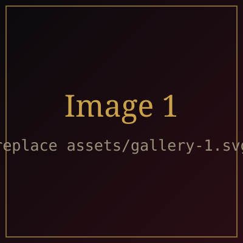
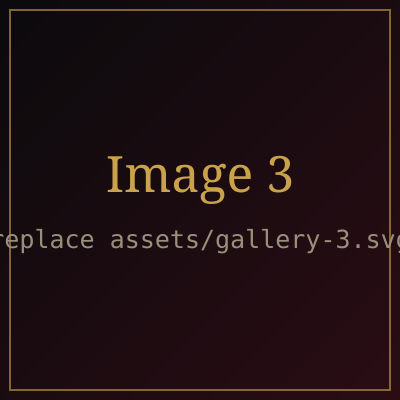

  

<h1 align="center">saintsblades</h1>

<i>Roblox developer · digital artist · musician</i>

  
  
  

## The Resident
- Hey! My name is Ayden.
- Based out of San Francisco, California, USA.

## The Workshop
- 3 years coding in Luau
- 1M+ visits on Roblox
- 37k monthly listeners on Spotify, 40 songs and many more to come
- 22k followers on TikTok for my digital art, 1.1M+ likes on my animations

`Roblox Studio` `Luau` `Blender` `Moon Animator` `FL Studio` `Procreate / ibispaint`

## The Gallery

  
  
  

## The Studio
- Updating my portfolio and writing new music
