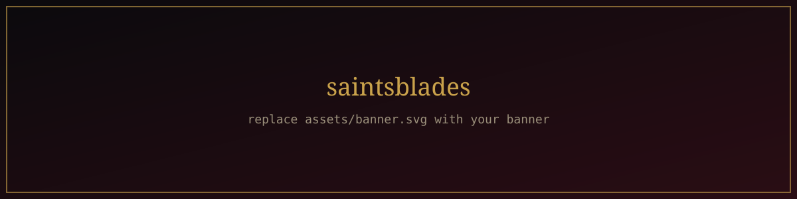
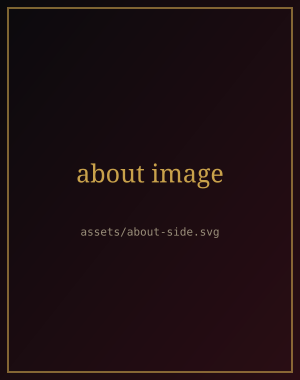
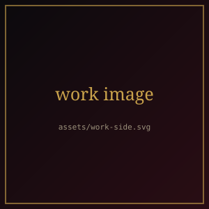
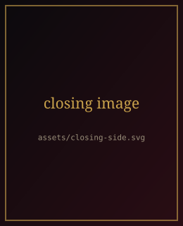
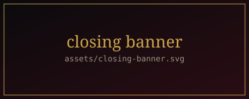
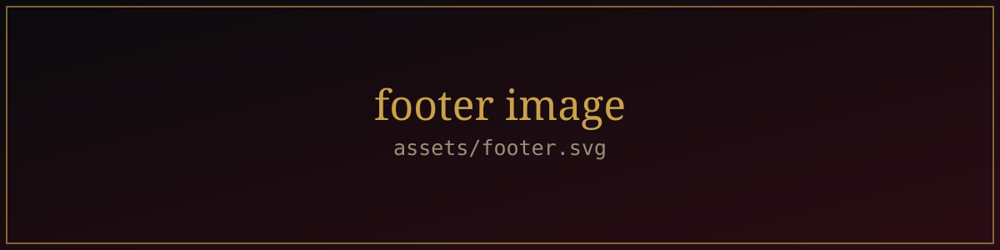

### The Resident

- **Name:** Ayden, also known as **saintsblades**
- **Location:** San Francisco, California, USA
- **Does:** Roblox development, digital art and music
- **Songs:** 40 and many more to come, 37k monthly listeners on Spotify

 

### The Workshop

- 3 years coding in Luau
- 1M+ visits on Roblox
- 22k followers on TikTok for my digital art, 1.1M+ likes on my animations
- **Tools:** Roblox Studio, Luau, Blender, Moon Animator, FL Studio, Procreate and ibispaint

 

### The Studio

- Updating my portfolio and writing new music
- Latest release: **When I jump, I will be free**

 

 
Add a favorite quote or lyric here.

  

  
  
  

