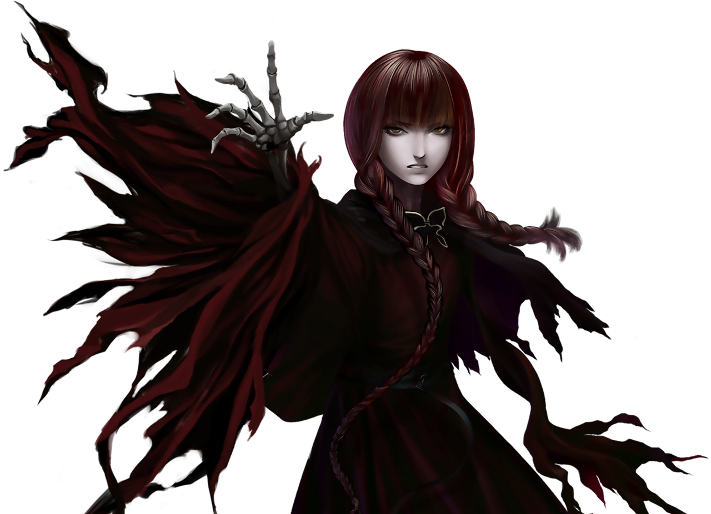

  
  
  

<i>Roblox developer · digital artist · musician</i>

<table width="100%">
<tr>
<td align="center" valign="middle" width="40%">

</td>
<td valign="top" width="60%">
<h3>The Resident</h3>
<ul>
<li><b>Name:</b> Ayden, also known as <b>saintsblades</b></li>
<li><b>Location:</b> San Francisco, California, USA</li>
<li><b>Does:</b> Roblox development, digital art and music</li>
</ul>
<h3>The Workshop</h3>
<ul>
<li>3 years coding in Luau</li>
<li>1M+ visits on Roblox</li>
<li>22k followers on TikTok for my digital art, 1.1M+ likes on my animations</li>
<li><b>Tools:</b> Roblox Studio, Luau, Blender, Moon Animator, FL Studio, Procreate and ibispaint</li>
</ul>
</td>
</tr>
<tr>
<td colspan="2" align="center">
<h3>The Studio</h3>
40 songs and many more to come · 37k monthly listeners on Spotify 
Latest release: <b>When I jump, I will be free</b> 
Updating my portfolio and writing new music  
Add a favorite quote or lyric here.
</td>
</tr>
</table>

